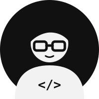

---
hide:
  - toc
---

<strong>Nguyen Hien Lam</strong> Senior Software Engineer · Kuala Lumpur

# Hello, I build backend systems that keep working

I have been writing software professionally since 2006: Java first, then .NET, Android and iOS,
and for the last years Python and AWS, on products used by millions of customers. I have worked
in Malaysia since 2010, mostly with international teams.

Working across many stacks taught me that the hard parts stay the same: transactions, caching,
retries, isolation, safe deploys. So I pick up a new tool by mapping it to patterns I already
know, and I care about the parts that usually break in production.

## At work

- **Backend microservices** in Python and Django, used by Android, iOS, desktop and web clients.
- **Serverless services on AWS**: Lambda, API Gateway, SQS, SNS, DynamoDB, Kinesis.
- **Cloud security**: least-privilege IAM, KMS encryption, Secrets Manager, WAF.
- **Breaking up a monolith** into domain services, and migrating live data with zero downtime:
  dual writes, idempotent backfill scripts, consistency checks, a reversible cut-over.
- Earlier: tech lead on a cloud ERP (.NET), and co-founder of a mobile team (Android, iOS).

## In my labs

Personal projects where I build a complete system end to end, with the tests to prove it:

- **Multi-tenant SaaS**: per-customer data on separate database shards, enforced by the code.
- **Embeddable web apps** that work inside partner sites, even with third-party cookies blocked.
- **APIs that stay correct under load**: rate limits, safe retries, no lost updates.
- **Deploys that roll back by themselves**, built without Kubernetes, tested without root.
- **CI and supply-chain security**: pinned dependencies, image scanning, SBOM.

The write-ups are coming to [Projects](projects/index.md); the stories behind them are on the
[Blog](blog/index.md).

## Latest posts

--8<-- "latest-posts.md"

## Currently learning

**AI-assisted development**: writing specs and plans for coding agents, reviewing their work,
setting guardrails, and managing context in long multi-step tasks.

## Get in touch

The best way is [LinkedIn](https://www.linkedin.com/in/lam-nguyen-723b279/). You can also
[open an issue](https://github.com/rossbeto/rossbeto.github.io/issues/new?template=contact.yml)
on this site's repository: issues are public, so please keep personal details out of it.
